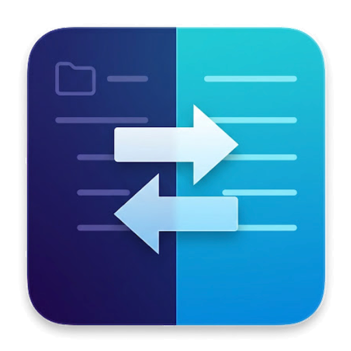
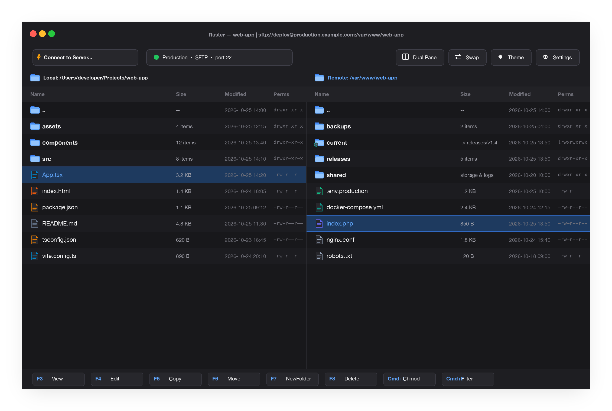
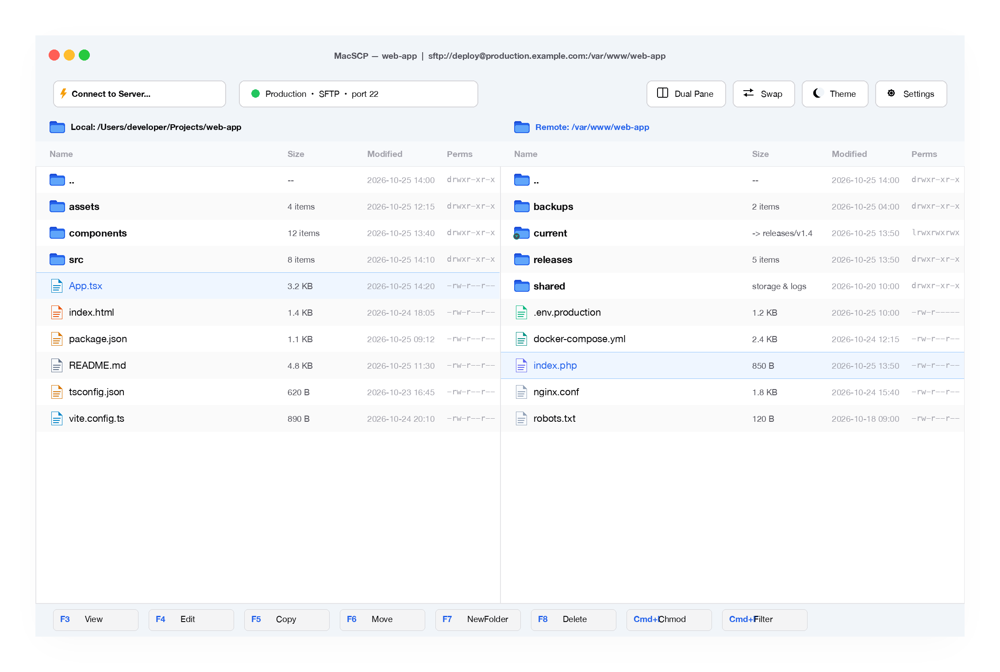

<p align="center">
  
</p>

<h1 align="center">MacSCP</h1>

<p align="center">
  <strong>Native, lightning-fast dual-pane SFTP & SCP client for macOS built with Rust & GPUI.</strong>
</p>

<p align="center">
  <a href="https://github.com/profectus/macSCP/releases"></a>
  <a href="https://github.com/profectus/macSCP/blob/main/LICENSE"></a>
  <a href="https://apple.com/macos"></a>
  <a href="https://www.rust-lang.org/"></a>
  <a href="https://buymeacoffee.com/filipstencl"></a>
</p>

<p align="center">
  <picture>
    <source media="(prefers-color-scheme: dark)" srcset="assets/screenshot-dark.png">
    <source media="(prefers-color-scheme: light)" srcset="assets/screenshot-light.png">
    
  </picture>
</p>

---

## Screenshots

| Dark Theme | Light Theme |
| :---: | :---: |
|  |  |

---

## Features

- **GPU-Accelerated Performance** — Built on Zed's modern GPUI framework with 120fps fluid scrolling, instant startup, and zero bloat.
- **Classic Dual-Pane Commander** — Effortlessly browse and manage local and remote files side by side. Toggle between dual-pane and single-pane modes (`Cmd+D`) or swap panes (`Cmd+U`).
- **Light & Dark Themes** — Pixel-perfect Light and Dark themes with native macOS dark titlebar synchronization.
- **10 Built-in World Languages** — Full localization available directly from Settings (`Cmd+,`):
  - 🇬🇧 English, 🇨🇿 Čeština, 🇩🇪 Deutsch, 🇪🇸 Español, 🇫🇷 Français, 🇮🇹 Italiano, 🇵🇱 Polski, 🇵🇹 Português, 🇨🇳 简体中文, 🇯🇵 日本語.
- **Site Manager & Bookmarks** — Save connections with custom environment color badges (Production, Staging, Dev), private key authentication, and custom SSH ports.
- **Background Transfer Queue** — Multi-item queue with real-time transfer speeds, progress bars, auto-retry, and batch controls.
- **Remote File Editing & Auto-Upload** — Edit remote files directly in your favorite local editor with automatic upload on save.
- **Visual chmod Calculator** — Inspect and set permissions via octal input and interactive bit checkboxes with recursion support.
- **Directory Synchronization** — Compare local and remote folders and synchronize missing or newer files with dry-run previews.
- **Instant Quick Filter** — Filter thousands of files in milliseconds using `Cmd+F`.

---

## Installation

### Option 1: Via Homebrew (Recommended)

You can install MacSCP directly via Homebrew:

```bash
# Add the MacSCP tap and trust it
brew tap profectus/macscp https://github.com/profectus/macSCP.git
brew trust profectus/macscp

# Install MacSCP
brew install --cask macscp
```

### Option 2: Direct Download

1. Download the latest `MacSCP.zip` from [GitHub Releases](https://github.com/profectus/macSCP/releases).
2. Unpack `MacSCP.zip`.
3. Drag `MacSCP.app` into your `/Applications` folder.

> [!TIP]
> **macOS Gatekeeper ("App cannot be opened" / "Apple cannot verify...")**:  
> Since MacSCP is an open-source project and built without a paid Apple Developer certificate, macOS Gatekeeper may show a security prompt upon first opening. To open it:
> - In **System Settings → Privacy & Security**, scroll down and click **Open Anyway**.
> - Or in Terminal, run: `xattr -dr com.apple.quarantine /Applications/MacSCP.app`
> - Or install via Homebrew with: `brew install --cask --no-quarantine macscp`

---

## Updates

### Updating via Homebrew
Whenever a new version is released, simply run:

```bash
brew update && brew upgrade --cask macscp
```

### In-App Update Notifications
MacSCP includes a built-in update checker:
- **Automatic Check**: On launch, MacSCP quietly checks GitHub Releases for new updates. If a newer version is available, an update window notifies you with release details.
- **Manual Check**: You can manually verify updates at any time by choosing **MacSCP → Check for Updates...** from the menu bar or clicking **Check for Updates** in Settings (`Cmd+,`).
- If you use Homebrew, the dialog provides a one-click button to copy `brew update && brew upgrade --cask macscp` to your clipboard.

---

## Keyboard Shortcuts

| Shortcut | Action |
| :--- | :--- |
| <kbd>Cmd</kbd> + <kbd>O</kbd> | Open Site Manager |
| <kbd>Cmd</kbd> + <kbd>D</kbd> | Toggle Dual Pane / Single Pane |
| <kbd>Cmd</kbd> + <kbd>U</kbd> | Swap Left and Right Panes |
| <kbd>Cmd</kbd> + <kbd>R</kbd> | Refresh File Lists |
| <kbd>Cmd</kbd> + <kbd>F</kbd> | Toggle Quick Filter |
| <kbd>Cmd</kbd> + <kbd>,</kbd> | Settings & Language Dropdown |
| <kbd>Cmd</kbd> + <kbd>Shift</kbd> + <kbd>.</kbd> | Toggle Hidden Files |
| <kbd>Cmd</kbd> + <kbd>Shift</kbd> + <kbd>G</kbd> | Go to Folder |
| <kbd>Cmd</kbd> + <kbd>I</kbd> | File Permissions (chmod) |
| <kbd>F5</kbd> | Copy / Transfer Selected |
| <kbd>F6</kbd> | Move / Rename Selected |
| <kbd>F7</kbd> | Create New Folder |
| <kbd>F8</kbd> / <kbd>Backspace</kbd> | Delete Selected |
| <kbd>Space</kbd> | Multi-select Toggle |

---

## Building from Source

### Prerequisites
- macOS 12.0 (Monterey) or later
- [Rust toolchain](https://rustup.rs/) (stable)
- Xcode Command Line Tools (`xcode-select --install`)

### Build Steps

```bash
# Clone the repository
git clone https://github.com/profectus/macSCP.git
cd macSCP

# Run tests
cargo test

# Build and package the release application bundle
./bundle.sh
```

The compiled and signed `.app` bundle will be ready at `target/release/MacSCP.app`, and a distributable archive will be at `target/release/MacSCP.zip`.

---

## Support the Project

If you love MacSCP and want to support its ongoing development and maintenance, you can buy me a coffee! Any support is greatly appreciated.

<p align="center">
  <a href="https://buymeacoffee.com/filipstencl" target="_blank">
    
  </a>
</p>

---

## License

This project is licensed under the [MIT License](LICENSE).
